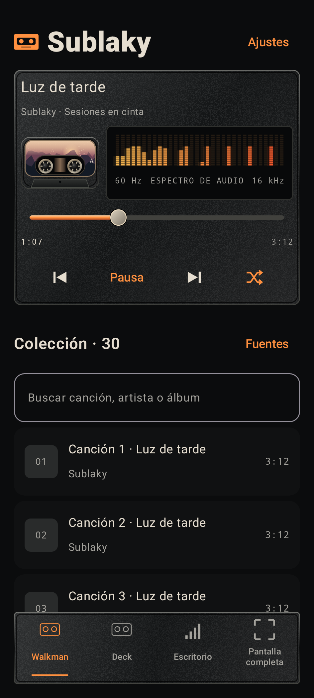

# Sublaky

Reproductor local Android con Kotlin, Jetpack Compose y Media3. Versión 1.1.4, Edición nocturna. Android 8.0 o posterior (API 26), objetivo API 36.



La preparación para F-Droid, las comprobaciones realizadas y los pasos pendientes están en [F_DROID.md](F_DROID.md). La app todavía no está publicada en F-Droid.

## Abrir y compilar

Abre esta carpeta como proyecto en Android Studio, selecciona JDK 17 y configura Android SDK 36 con Build Tools 35.0.0. El Gradle Wrapper fija Gradle 8.13. Dependencias con versiones fijas en los archivos de compilación; se descargan desde Google Maven y Maven Central.

En este PC también puedes ejecutar `./build-local.ps1`: usa las herramientas portátiles preparadas en `../../work/toolchain` y la caché en `../../work/gradle-cache`. No modifica el PATH del sistema. Para otro PC, usa Android Studio o configura JAVA_HOME y ANDROID_HOME y ejecuta:

```powershell
./gradlew.bat assembleDebug testDebugUnitTest lintDebug
```

APK de prueba: `app/build/outputs/apk/debug/app-debug.apk`. Se firma automáticamente con una clave de desarrollo y usa el identificador `org.sublaky.player.debug`. Puedes copiarlo al teléfono e instalarlo permitiendo instalaciones desde la aplicación que lo abra. No requiere ADB ni Google Play. No usar esa clave para una distribución estable.

## Lo implementado

- Biblioteca MediaStore con solicitud de permiso de audio acorde con la versión de Android.
- Selección de carpetas mediante Storage Access Framework y acceso persistente; se pueden olvidar desde Ajustes.
- Escaneo fuera del hilo de interfaz, cancelable al reescanear. MP3, AAC/M4A, FLAC, OGG y Opus; WAV opcional.
- Exclusión opcional de archivos sin artista/álbum cuyo nombre o carpeta sugiera notas de voz. Es una heurística, no un detector infalible.
- Cola a partir de la biblioteca, reproducción/pausa, anterior/siguiente y búsqueda temporal.
- Reproducción aleatoria activable en todos los modos; conserva la canción actual y guarda la preferencia.
- Diseño de cassette con carcasa, cinta, bobinas animadas suavemente, pantalla de información y controles de transporte.
- Carcasa negra texturizada, bordes metálicos, controles iluminados en naranja y selector inferior de cuatro modos. La opción automática sigue disponible en Ajustes.
- La carátula cubre la etiqueta del cassette. Cuando no existe, aparece un paisaje original dibujado por la app.
- Visualizador de 32 bandas logarítmicas a partir del PCM decodificado por Media3. Sin permiso de micrófono ni grabación; se suspende el análisis cuando no hay un visualizador activo y visible.
- Carátula embebida de la canción actual, extraída localmente y decodificada con tamaño limitado fuera del hilo de interfaz; etiqueta propia cuando no existe.
- Búsqueda por título, artista o álbum, duración por pista y canción activa destacada en la colección.
- MediaSessionService: reproducción en segundo plano, controles del sistema, foco de audio y pausa al desconectar auriculares.
- Walkman, Deck, Escritorio, Pantalla completa y elección automática. Composición de dos columnas en pantallas anchas; controles accesibles mediante desplazamiento en pantallas pequeñas. Pantalla completa oculta las barras del sistema.
- Preferencias persistentes; ilustración vectorial de cassette propia, sin assets descargados.

Los archivos que Android no indexa pueden requerir seleccionar su carpeta. Android restringe determinadas carpetas, como Android/data; Sublaky no evita esas restricciones. Un mismo archivo expuesto por MediaStore y un proveedor de documentos puede aparecer dos veces porque sus URI son distintas. Solo se deduplican URI idénticas.

## Arquitectura

- `domain`: Track, ScanPolicy y VisualMode, con pruebas JVM para las reglas de selección.
- `data`: MusicRepository, consulta MediaStore y recorre árboles de documentos.
- `playback`: PlaybackService, único propietario de ExoPlayer y MediaSession.
- `PlayerViewModel`: estado observable, preferencias, escaneo y conexión MediaController.
- `MainActivity`: interfaz Compose y entrada de permisos/selección de carpetas.

## Alcance de la edición

La biblioteca se reconstruye al abrir la app; aún no hay índice Room, observación automática de cambios, edición de cola ni restauración de cola tras morir el proceso. Las bobinas son decorativas: no representan el espectro de audio. Los modos tienen composiciones adaptadas: Walkman compacto, Deck horizontal cuando cabe, Escritorio con colección lateral en ventanas anchas y Pantalla completa con cassette protagonista. La reproducción depende de los códecs admitidos por Media3 y el dispositivo.

## Visualizador

`SpectrumSink` observa una copia del PCM mediante `TeeAudioProcessor`; no modifica los bytes enviados a la salida. La salida se configura para PCM (sin passthrough comprimido) para que el analizador pueda recibir muestras. `SpectrumAnalyzer` aplica una ventana Hann y FFT de 2048 muestras, y agrupa de 60 Hz a 16 kHz (o Nyquist si es menor). Las barras se normalizan en dBFS y se suaviza su caída en pantalla. El análisis ocurre antes de la salida: puede adelantarse ligeramente al sonido debido al buffer del dispositivo; no es un instrumento de medición calibrado.

En estéreo se toma el canal de mayor amplitud instantánea para evitar cancelaciones entre canales en contrafase. No se almacena audio ni se obtiene audio de otras apps. Hay pruebas con silencio, tonos, volumen, frecuencias de muestreo y preservación byte por byte de la salida del procesador.

## Revisión visual

El proyecto incluye vistas de prueba en `app/src/screenshotTest`. `updateDebugScreenshotTest` genera imágenes desde el mismo código Compose para revisar proporciones y texto ampliado, sin emulador. Se utiliza el plugin oficial experimental de Android, solo para desarrollo; no se empaqueta en el APK. Documentación: https://developer.android.com/studio/preview/compose-screenshot-testing

## APK estable y F-Droid

El código y las ilustraciones originales se entregan bajo MIT. Sin permiso INTERNET, telemetría, publicidad, Firebase ni Google Play Services. Las dependencias son AndroidX y Kotlin; el uso de Google Maven como repositorio de compilación no añade servicios de Google al APK.

`./gradlew.bat assembleRelease` genera una versión release sin firmar. Para distribuir una versión estable, crea y conserva tu propia clave desde **Build > Generate Signed Bundle / APK** en Android Studio. No guardes claves ni contraseñas en Git. Conserva siempre la clave para futuras actualizaciones.

Para solicitar inclusión en F-Droid faltan: repositorio público, revisión completa de dependencias/licencias, etiquetas de versiones, metadatos con URL real del repositorio y validación por F-Droid. No se ha publicado ni enviado una solicitud. La compatibilidad futura es un objetivo, no una aprobación de F-Droid.

Referencias oficiales:
- https://developer.android.com/media/media3/session/background-playback
- https://developer.android.com/training/data-storage/shared/media
- https://f-droid.org/docs/Inclusion_Policy/
- https://f-droid.org/docs/FAQ_-_App_Developers/
